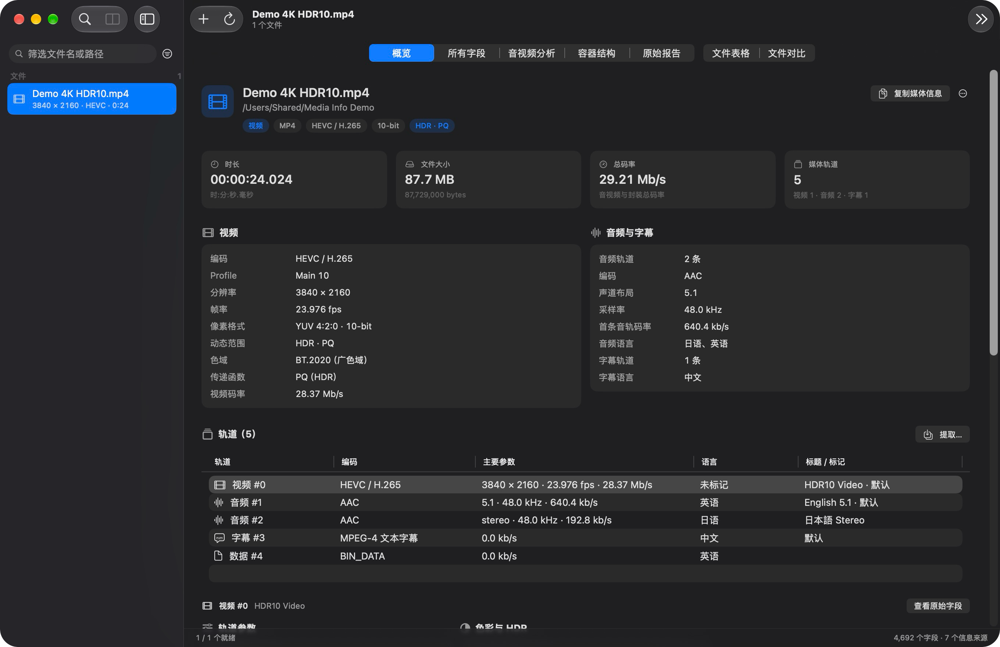
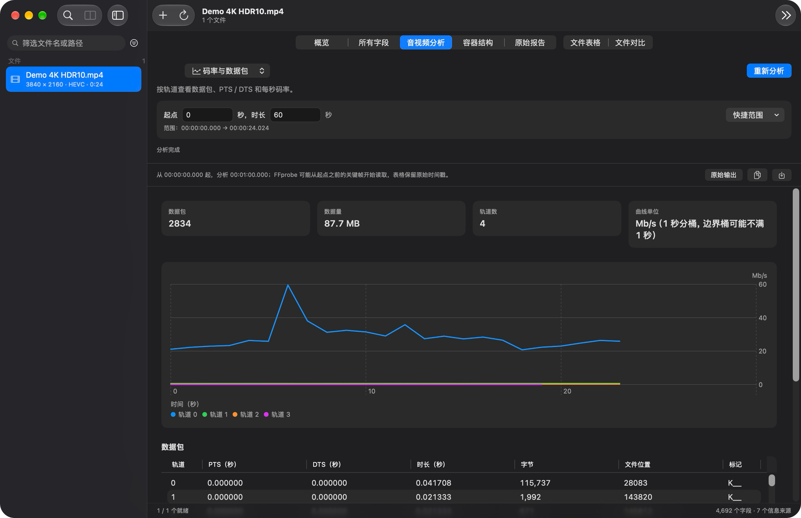

# Media Info

**原生 macOS 媒体信息检查工具**

编码、轨道、HDR、码率和容器结构，一个窗口看完。内置 14 个解析引擎，无需安装 Homebrew，完全离线。

作者：[Andyshenjx](https://github.com/Andyshenjx) · **macOS 27+** · **Apple Silicon** · 免费使用

介绍网站：<https://andyshenjx.github.io/Media-Info-Mac/>

> 本项目是独立开发的工具，与 MediaArea 的 MediaInfo 无关联。应用内置了 MediaInfo CLI 等第三方开源工具，见 [第三方组件](THIRD_PARTY_NOTICES.md)。

## 界面展示

### 概览

### 音视频分析

## 下载与安装

前往 [Releases](https://github.com/Andyshenjx/Media-Info-Mac/releases/latest) 下载 **Media-Info-1.0-macOS-arm64.dmg**，打开后把「Media Info」拖进「应用程序」文件夹。

- 需要 **macOS 27 或更新版本**，以及 **Apple Silicon（M 系列）Mac**。
- 下载约 **63 MB**，安装后约 210 MB：内置的 14 个工具及其依赖占了大部分空间。
- 安装包由作者从源码编译（Release，2026-11-22），使用本地签名。已在作者的 Mac 上实际打开，读取 4K HDR10 演示文件和码率分析正常；其他功能未逐项测试。
- 没有 Developer ID 签名和苹果公证。第一次打开如果被系统阻止：先确认是从本页下载的，然后打开「系统设置 → 隐私与安全性」，在页面下方点「仍要打开」。

## 功能

| 模块 | 能力 |
| --- | --- |
| 导入 | 文件、文件夹递归扫描、拖放、Finder「打开方式」、最近项目 |
| 概览 | 时长、大小、码率和轨道；编码、语言、色彩、HDR10 / HDR10+ / Dolby Vision、MaxCLL / MaxFALL |
| 所有字段 | 多引擎字段合并，按来源和分组筛选，全文搜索，复制完整值 |
| 文件表格与对比 | 多文件排序、列选择；并排对比不同项或全部字段 |
| 音视频分析 | 数据包、PTS / DTS、每秒码率、I / P / B 帧、关键帧、GOP、帧间隔 |
| 检测与测量 | EBU R128 响度、True Peak、静音、黑场、画面冻结、解码诊断 |
| 图像结果 | 音频波形、带时间位置的视频缩略图 |
| 容器结构 | MP4 / MOV / HEIF 的 Box 层级、偏移、大小和十六进制预览 |
| 提取 | 单轨道重新封装、原编码文件、WAV、字幕格式转换、章节、MKV 附件 |
| 报告 | TXT、JSON、CSV、HTML、XML 和自定义文本模板 |

## 内置引擎

FFmpeg / FFprobe、MediaInfo CLI、ExifTool、Exiv2、Bento4 mp4dump、GPAC MP4Box、MKVToolNix、GStreamer、LibRaw、libheif、libsndfile，加上系统的 AVFoundation 和 Image I/O。

全部随应用内置，可以在「设置 → 解析引擎」里逐个开关，或改用自己安装的版本。GStreamer、Exiv2、LibRaw、libheif、libsndfile 默认关闭，需要时再勾选。

## 隐私

- 完全离线：应用没有网络权限，不上传任何文件或数据，没有统计代码。
- 运行在 App Sandbox 中，只读写你选择的文件和文件夹。

## 第三方组件

内置工具分别采用 LGPL、GPL、BSD 等开源许可，版本、许可和源码地址见 [THIRD_PARTY_NOTICES.md](THIRD_PARTY_NOTICES.md)。完整许可文本和逐文件清单随应用附带，位于 `Media Info.app/Contents/Resources/Licenses/`。

本仓库只发布安装包，不包含应用源码。

## 赞赏

如果这个工具对你有帮助，可以自愿赞赏支持维护。赞赏不影响任何功能。

## 反馈与免责声明

欢迎通过 [Issues](https://github.com/Andyshenjx/Media-Info-Mac/issues) 提交问题，请注明 macOS 版本、Mac 芯片、文件格式和复现步骤。分享媒体文件或报告前，请自行检查其中的拍摄地点、设备序列号等个人信息。

本软件按「原样」提供，不附带任何担保。各第三方工具的名称和商标归各自权利人所有。
